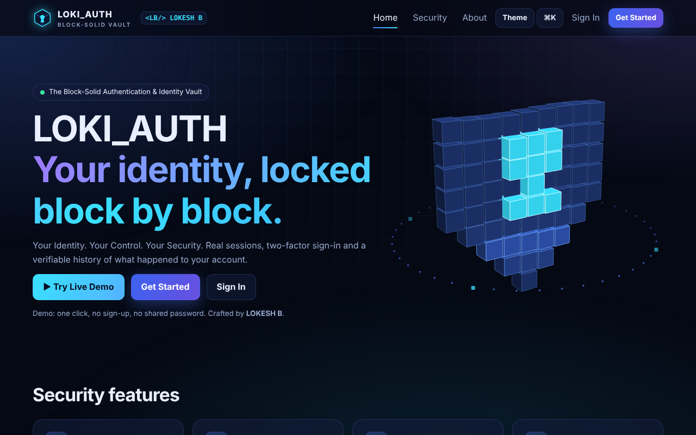
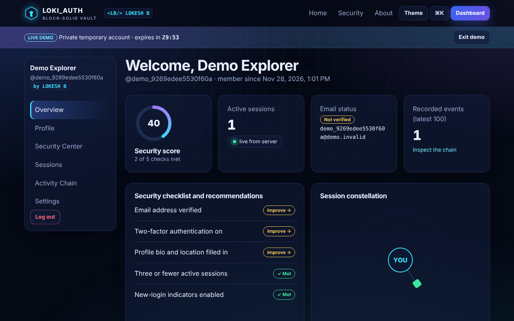
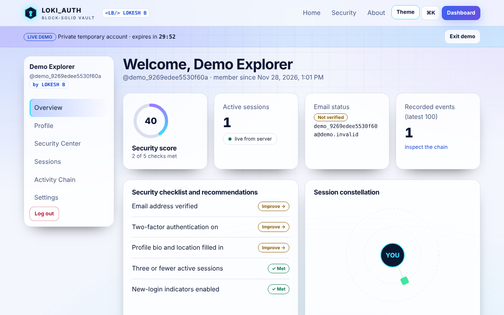
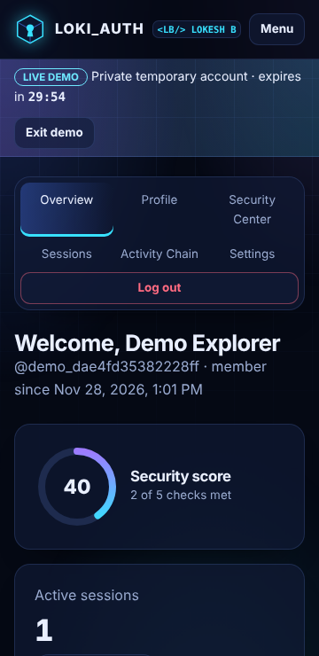

# 🛡️ LOKI_AUTH — The Block-Solid Authentication & Identity Vault
**Your Identity. Your Control. Your Security.** · Created by **LOKESH B** `<LB/>`

A full-stack authentication and identity platform with **zero npm dependencies**.

## Features
- Register, sign in (email or username), remember-me, logout
- Email verification and password reset (needs an email provider)
- TOTP two-factor with recovery codes and replay protection
- Session manager: revoke one, revoke others, log out everywhere
- **Activity Chain**: HMAC-linked security events with an integrity check
- One-click disposable live demo, expired by the server
- 3D voxel vault, session constellation, command palette (Ctrl/⌘+K), dark/light, reduced-motion support

## Screenshots
| Landing | Dashboard |
|---|---|
|  |  |




## Stack and architecture
Node.js ≥ 22.13 (`node:http`, `node:crypto`, `node:sqlite`, `fetch`), vanilla HTML/CSS/JS, SQLite locally, Turso (libSQL HTTP API) in production.
The brief preferred Express. It was not available in the build environment (package installs were off), so routing uses `node:http`.

`Browser → headers → Origin + CSRF → rate limit → session/authorization → parameterized SQL`

```
server.js          startup and graceful shutdown
src/config.js      environment validation
src/db.js          SQLite + Turso drivers, migrations
src/security.js    scrypt, tokens, AES-GCM, TOTP
src/validation.js  server-side input rules
src/services.js    sessions, activity chain, rate limits, demo, cleanup
src/routes.js      API
src/app.js         HTTP, security headers, CSRF, static files, error logging
src/email.js       email adapter
public/            frontend
preview/           simulation used only by the static preview
test/              automated tests
```

## Run locally
```bash
npm ci
npm start                 # http://localhost:3000
```
Open it with exactly that address: the Origin check must match `BASE_URL`.
To try verification and reset without a provider (development only):
```bash
EMAIL_PROVIDER=file npm start     # links are written to data/outbox.log
```
To keep 2FA and chain verification working across restarts, set `APP_SECRET`: copy `.env.example` to `.env`, then `node --env-file=.env server.js`.

`npm run build` creates `dist/LOKI_AUTH-static-preview.html`. It is a **simulation** for viewing the design, with no real security.

## Configuration
| Variable | Purpose |
|---|---|
| NODE_ENV, PORT, HOST | Runtime. Production defaults to `0.0.0.0` |
| APP_SECRET | 32+ characters, required in production. Changing it invalidates 2FA secrets, existing chain hashes and CSRF tokens |
| BASE_URL | Public origin. Falls back to Render's `RENDER_EXTERNAL_URL`. Set it for a custom domain |
| DB_DRIVER, SQLITE_PATH, TURSO_URL, TURSO_TOKEN | Database. Production requires Turso |
| DEMO_TTL_MS | Demo lifetime (default 30 minutes) |
| EMAIL_PROVIDER, EMAIL_FROM, RESEND_API_KEY | `none`, `resend`, or `file` (development) |
| TRUST_PROXY | Read the proxy's X-Forwarded-For entry (default on in production) |

## Database
Tables: users, profiles, user_preferences, sessions, email_verification_tokens, password_reset_tokens, recovery_codes, activity_logs, demo_accounts, rate_limits, account_deletions, schema_migrations. Migrations run at startup; add new ones to the end of `MIGRATIONS`. Foreign keys cascade. If the database is unreachable the app refuses to start; it never switches to a local file.

### Turso setup
Create a database in the Turso dashboard (or `turso db create loki-auth`), then copy its URL (`turso db show loki-auth --url`) and a token (`turso db tokens create loki-auth`). Enter both only as environment variables.

### Email (Resend)
Create an API key and a verified sender at Resend, then set `EMAIL_PROVIDER=resend`, `RESEND_API_KEY` and `EMAIL_FROM`. Without a provider the UI says no email is sent.

## Deploy to Render
1. Push this folder to GitHub.
2. In Render: New → Blueprint → select the repository (`render.yaml`).
3. Enter `TURSO_URL` and `TURSO_TOKEN` when asked. `APP_SECRET` is generated.
4. Deploy, then check `/api/health` and run the demo.

Free-tier notes: the service sleeps when idle, so the first request can be slow; local files do not persist, which is why Turso is used; Turso and the email provider have their own limits. Check current terms with each provider.

## API
Responses: `{success, message, data}`; errors: `{success:false, message, error:{code, fields}}`.
Every non-GET request needs a matching `Origin`, `Content-Type: application/json` and `X-CSRF-Token` from `GET /api/csrf`. 🔒 = session required.

| Method and path | Body / notes |
|---|---|
| GET /api/health, /api/config, /api/csrf | public |
| POST /api/auth/register | fullName, username, email, password, confirmPassword, acceptTerms |
| POST /api/auth/login | identifier, password, remember, code (2FA) |
| POST /api/auth/logout 🔒 · GET /api/auth/me 🔒 | |
| POST /api/auth/forgot-password | email |
| POST /api/auth/reset-password | token, password, confirmPassword |
| POST /api/auth/verify-email | token |
| POST /api/auth/resend-verification 🔒 | |
| POST /api/auth/change-password 🔒 | currentPassword, password, confirmPassword |
| POST /api/mfa/setup, /enable, /disable 🔒 | currentPassword (setup, disable); code (enable) |
| GET, PATCH /api/profile 🔒 | fullName, username, bio, location, theme, loginAlerts |
| GET /api/sessions 🔒 · DELETE /api/sessions/:id 🔒 | |
| POST /api/sessions/revoke-others 🔒 | |
| POST /api/sessions/logout-all 🔒 | currentPassword |
| GET /api/activity, /api/activity/verify 🔒 | latest 100 events; full chain check |
| POST /api/demo/start · POST /api/demo/test-session 🔒 | demo |
| DELETE /api/account 🔒 | confirm:"DELETE", currentPassword |

## Security design
scrypt (N=32768, r=8, p=1) with at most 4 hashes in parallel · 256-bit tokens stored as SHA-256 · HttpOnly, SameSite=Strict cookies (`__Host-` + Secure in production) · new token on every login · signed CSRF tokens + exact Origin · strict CSP, HSTS in production · database-backed rate limits · escaped-by-default rendering · static allow-list (no filesystem lookups from URLs) · reset/verify tokens carried in the URL fragment · TOTP secrets encrypted with AES-256-GCM · no CORS.

## Demo behaviour
There are **no shared demo credentials**. "Try Live Demo" creates a unique account with a random password that is never shown. Password change, 2FA, email verification and username change are disabled. Because no password exists for the user, demo logout-all and deletion need no password (deletion still needs typing DELETE). "Create test session" adds a real, labelled session row so revocation can be tried on one device. Access ends at expiry; rows are hard-deleted about 1 hour later by a cleanup that runs every minute while the server is awake, and at each demo start.

## Tests
```bash
npm run check && npm test
```
Tests use in-memory or temporary databases only. Coverage percentage has not been measured. The Turso tests use a local stand-in for the HTTP protocol, **not the real Turso service**. With no dependencies there are no third-party packages to audit.

## Troubleshooting
- **"Request origin was rejected"**: the address in the browser differs from `BASE_URL` (for example 127.0.0.1 vs localhost).
- **"Database unavailable"**: check `DB_DRIVER`, `TURSO_URL`, `TURSO_TOKEN`.
- **429**: wait for the time in `Retry-After`.
- **2FA fails after restart**: set a fixed `APP_SECRET`. Also check the phone clock.
- **SQLite experimental warning**: expected on Node 22.

## Known limitations
- Not independently security-audited. Not yet run against real Turso, real Resend or a live Render deployment.
- Registration and username change reveal that an email/username is taken (required for field-level uniqueness errors); rate limits reduce abuse.
- Password login limits are per IP and per IP+account, so guessing spread over many IPs is not capped per account. 2FA helps.
- Check client-IP handling behind your proxy before relying on per-IP limits.
- The activity chain cannot detect removal of only the newest blocks, or forgery by someone holding APP_SECRET.
- No QR code for 2FA (manual key or otpauth link), no email-address change, no admin panel.
- New-login notices are in-app only. Reduced motion follows the device setting.
- Account deletion is immediate. Public page titles and meta tags are server-rendered; page body is rendered by JavaScript.

## License
MIT · **Author: LOKESH B**
